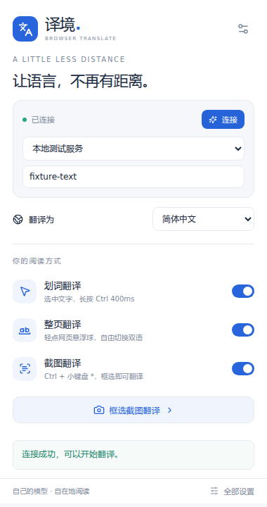

# 译境 · BrowserTranslate

使用自己的模型，让语言不再有距离。一个基于 WXT、React 和 TypeScript 的 Chrome Manifest V3 扩展。



## 安装

1. 从本仓库 **Releases** 下载 `BrowserTranslate-v0.1.1-chrome.zip` 并解压。
2. 在 Chrome 地址栏打开 `chrome://extensions`，开启右上角的「开发者模式」。
3. 点击「加载已解压的扩展程序」，选择直接包含 `manifest.json` 的解压目录。
4. 将「译境」固定到工具栏，打开扩展设置，添加供应商、Base URL、API Key 和模型。
5. 已经打开的网页请刷新一次。

最低支持 Chrome 124。适用于普通 HTTP/HTTPS 网页；Chrome 内部页面、Chrome 商店和内置 PDF 阅读器不支持页面翻译。

## 配置模型

Base URL 填 **API 根地址**，例如 `https://api.openai.com/v1`，也可以填写带自定义路径的兼容端点。扩展会追加 `/models` 或 `/chat/completions`，不会自动修改根路径。

支持保存多个供应商和切换模型。模型列表接口不可用时，直接手动输入精确模型 ID。点击「测试连接」会发送一次很短的真实请求，可能计入供应商用量。可为详细解释和视觉识别单独配置模型。

本地免密钥模型服务可将 API Key 留空。配置保存在本机扩展存储，不同步到云端；扩展未对本机存储做额外加密，请使用专用、有限额的 API Key。

## 使用

| 功能           | 操作                                                                                   |
| -------------- | -------------------------------------------------------------------------------------- |
| 划词翻译       | 选择网页文字，长按 Ctrl 400ms；Ctrl+C 等组合键不会触发                                 |
| 详细解释       | 点击翻译小窗的「详细」，搜索资料并解释词义、用法或句子结构                             |
| 整页翻译       | 点击网页边缘的翻译图标；译文显示在原文下方，支持仅译文、停止、重试和恢复原文           |
| 截图翻译       | Ctrl + 小键盘 *，或扩展弹窗中的「框选截图翻译」                                        |
| 标准截图快捷键 | 默认 Ctrl+Shift+Y，macOS 为 Command+Shift+Y；可在 `chrome://extensions/shortcuts` 修改 |

浮窗可拖动、固定和复制，Esc 可关闭未固定浮窗或取消框选。截图识别原文可编辑，再点击「重译」。整页翻译只处理普通文本段落，跳过代码、表单、可编辑区域；保留原节点，恢复时可保留原链接和事件。动态追加的段落会继续翻译。

### 截图的两种模式

- **本地 OCR（默认）**：随包内置 Tesseract Worker、WASM 和中英文语言数据，无需在线下载引擎。识别在本机完成，仅将识别文字发送到翻译供应商。
- **视觉模型**：先在设置里选择支持图片输入的模型，再切换识别模式。仅把框选后裁剪的图片发送给该视觉供应商，然后将识别文字交给翻译模型。

截图针对当前可视区域，不保存历史；框选期间请保持当前标签页和页面位置不变。复杂排版、小字号及非中英文文字建议使用视觉模型。

### Exa 联网解释

内置远程 MCP 服务 `https://mcp.exa.ai/mcp`，使用 `web_search_exa` 和 `web_fetch_exa`。免密钥模式受免费限流约束，可在设置中填写自己的 Exa API Key。

仅点击「详细」会触发搜索。发送精简选词或选句作为搜索查询；翻译模型会结合选区附近语境和搜索资料解释。只有实际检索到的来源显示为可点击出处。搜索不可用时仍提供模型解释，并明确显示「未完成联网查证」。模型与搜索结果可能出错，请结合来源判断。

## 本地开发

建议 Node.js 24 LTS 和 npm。依赖由 `package-lock.json` 固定。

```sh
npm ci
npm run dev
```

生产构建及验证：

```sh
npm run typecheck
npm test
npm run build
npx playwright install --with-deps chromium
npm run test:e2e
npm run zip
```

生产扩展目录为 `.output/chrome-mv3`。ZIP 的根目录直接包含 `manifest.json`。`npm run build` 自动从安装的 npm 包复制本地 OCR 资源，不把构建产物提交到 Git。

端到端测试在独立的临时 Chromium 配置中加载生产扩展，使用本机模拟 OpenAI 兼容端点，并运行真实离线 OCR；不读取个人浏览器配置，也不需要真实模型密钥。截图与失败轨迹写入忽略的 `artifacts/`、`test-results/`。

v0.1.1 已通过类型检查、30 项单元测试、3 条浏览器端到端流程及生产构建。Exa 免密钥搜索已实连验证，真实供应商模型翻译需用户配置自己的端点与密钥。

## 项目结构

- `entrypoints/`：后台、网页入口、弹窗、设置页和 OCR offscreen 页面。
- `src/core/`：配置与凭据隔离、兼容 API、Exa、截图裁剪、类型化消息。
- `src/content/`：划词、共享结果小窗、整页队列、正文恢复、框选交互。
- `src/ui/`：弹窗与设置页的共享组件及主题。
- `tests/`、`e2e/`：单元测试与真实扩展浏览器测试。

## 权限与数据

- `storage`：只在本机保存配置；设置为可信扩展上下文访问，内容脚本仅获取剔除密钥的配置。
- `<all_urls>`：在网页显示划词浮窗、悬浮球并支持网页内截图快捷键；同时允许后台连接用户指定的供应商。
- `activeTab`：响应用户主动点击的截图操作。
- `offscreen`：在扩展所属的隐藏页面中运行本地 OCR Worker。

仅在用户操作后发送待翻译文本、必要语境或框选图片到配置的服务。无自建后端、广告、使用分析或截图历史。详见 [隐私说明](PRIVACY.md)。

## 发布

版本号保存在 `package.json` 和扩展配置中，发布时保持一致。推送版本标签（如 `v0.1.1`）后，GitHub Actions 会重新验证并生成 Release 安装包。
