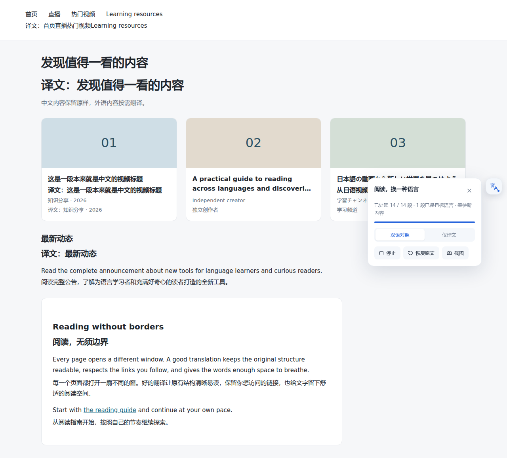
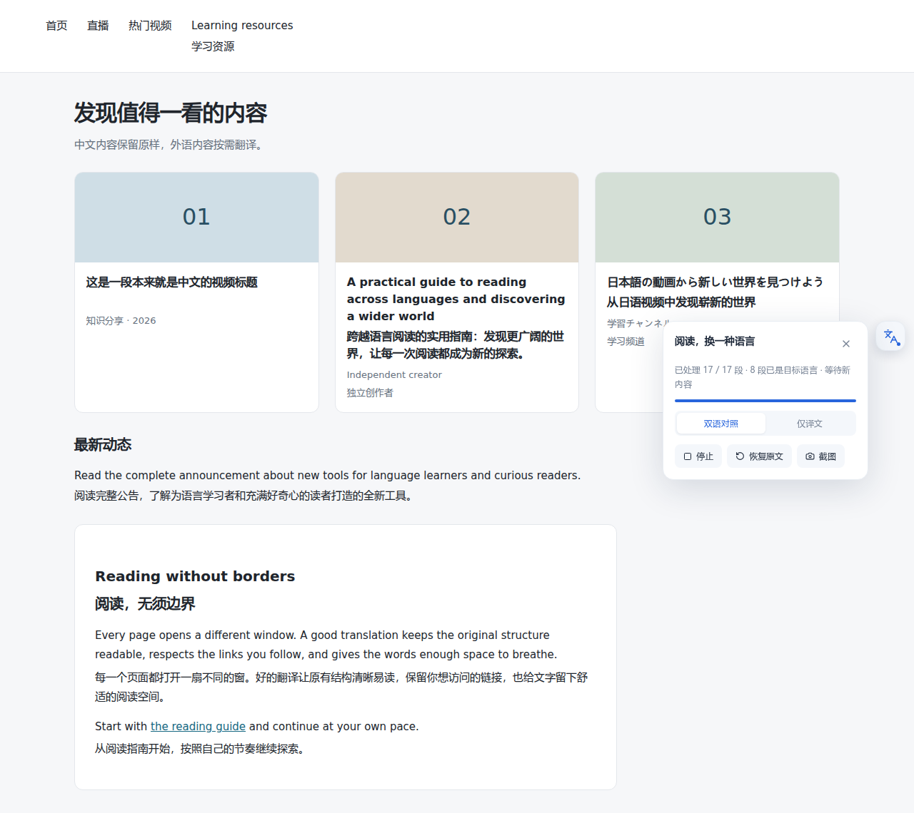
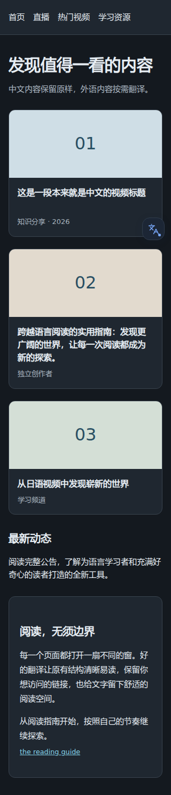

# v0.3.2 网页呈现与语言判断

## 短文本与链接

旧实现要求文本至少含 12 个字母，并且 Chrome 的语言检测结果可靠，才能确认已经是目标语言。因此「首页」「直播」和很多中文视频标题都会重新发送给模型。独立链接也未列为提取对象：几个导航链接可能被父容器拼成一个段落，译文插在点击区域外。

新实现为每个段落读取最近的 `lang` 声明；如果整段正文来自带独立语言声明的子链接或内联节点，则采用该节点的语言。脚本占比、日文假名、韩文和简繁变体检查仍先执行；声明为中文的网页不会让英文段落、日语视频或待转换的繁体内容被整体跳过。满足脚本检查且语言声明与目标一致时，短文本无需调用检测器。

对明确声明为中文的内容，除原来的 85% 字母占比外，也接受「至少 4 个汉字、最多 3 个拉丁词，按汉字与词计数时汉字不少于 80%」的标题。这使 Claude、Nana、AI 等少量名称不会因为字符长而压过中文正文。它是有限的启发式规则；包含较多外语、缺少语言声明或语言不明的短文本仍继续翻译。数字、时长和纯标点没有可翻译语言，提取时排除。

请求去重和最多 300 项的内存缓存按「语言声明 + 原文」区分，避免中文与日文共用汉字标题时错误复用跳过结果。页面动态修改 `lang` 后重判，模型只收到需要翻译的文字与短 ID，语言属性不会混入译文提示。

## 布局与恢复

独立导航及卡片链接逐项提取，段落内链接仍参与整句翻译。整段来自同一链接时，译文插入该原链接内部，保留原链接节点与事件；仅译文时隐藏原文字而保留点击目标，不再在译文下重复显示同一个原文链接。混合正文中的多个链接继续提供原链接入口。

仅对限制当前正文的 `nowrap`、裁切或限行样式释放高度与溢出空间，译文继承原页面字号、颜色和行高，不额外添加背景、边框或品牌色。双语保留上下间隔，仅译文去掉顶部间距。恢复时撤销本次修改，并保留网页后来写入的其他样式。窄屏菜单位于悬浮球上方，关闭按钮不会被球遮挡。

## 截图对照

使用同一份中英日混合导航、视频卡片和文章夹具，配合本机确定性模拟模型。旧版向模型发送 13 段，修复后发送 9 段、8 段中文保留原样。模拟输出用于验证布局和请求边界，不代表真实供应商翻译质量。

修复前：中文重复、导航合并，英文卡片标题译文被裁切。

修复后：中文保留，外语链接逐项显示完整译文。

320px 深色阅读模式，收起控制菜单后仍保留译文。

## 验证范围

- 单元测试覆盖短中文、夹带英文名称、简繁转换、日文纯汉字标题、同脚本不同语言、段落内链接、独立链接、纯数字、模式切换、样式恢复、语言缓存和动态语言变更。
- 真实 Chromium 加载生产扩展，检查译文点击、卡片译文与作者栏不重叠、导航保留、页面宽度不溢出，以及 320/768/1440px 明暗截图；切换模式和恢复后核对原 DOM。
- Bilibili 实站以独立临时浏览器和本机模拟端点观察语言判断及页面布局；内容随推荐变化，结果不作为稳定数量断言。实站截图留在忽略的 `artifacts/bilibili-*.png`。
- 发布通过现有 GitHub Actions 再次运行类型检查、单元测试、生产打包和浏览器回归。

本地最终验证：类型检查、93 项单元测试、13 项 Chromium 端到端测试和生产 ZIP 打包通过，运行时依赖审计无已知漏洞。自动化测试网页的未捕获异常、控制台警告及错误、扩展后台错误均为空。

2026-11-12 的一次 Bilibili 首页观察中，76 个文本块里 75 个跳过，只有 1 个混合外语标题进入模型请求，纯数字及视频时长不发送。网站自身的脚本产生两条 `Permissions policy violation: unload is not allowed in this document.`；在完全未加载扩展的独立 Chromium 中也复现相同来源、相同数量的报错。启用翻译后未观察到新增报错，扩展后台错误为空。完整对照日志在 `artifacts/console-check-browser-console.json` 和 `artifacts/bilibili-without-extension-console.json`。

## 参考

- [Chrome i18n.detectLanguage](https://developer.chrome.com/docs/extensions/reference/api/i18n#method-detectLanguage)：本地语言识别、可靠性和占比。
- [MDN line-clamp](https://developer.mozilla.org/en-US/docs/Web/CSS/Reference/Properties/line-clamp)：限行与裁切的组合行为。
- [MDN white-space](https://developer.mozilla.org/en-US/docs/Web/CSS/Reference/Properties/white-space)：文本换行行为。
